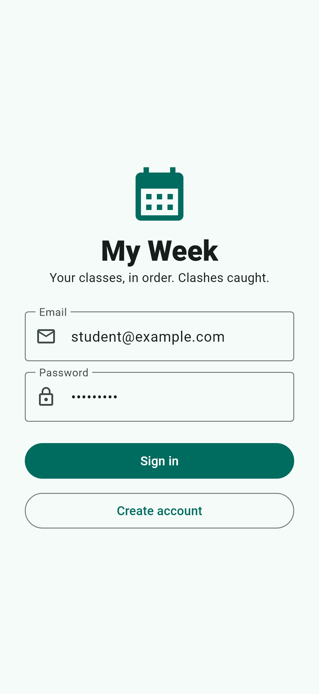
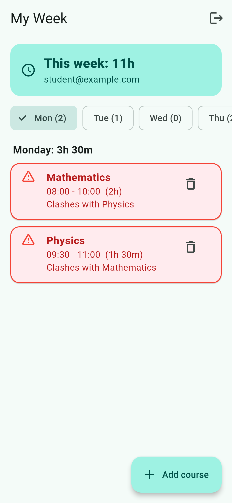
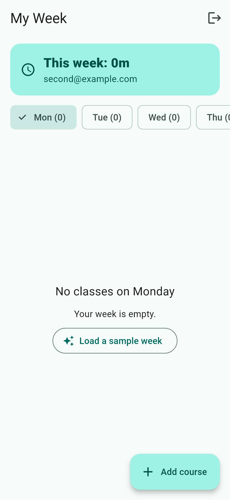

# My Week

My Week is a weekly class planner that keeps your courses in order, adds up your hours and warns you in red when two courses clash. It signs users in with Firebase Authentication, and each user's data is saved in Cloud Firestore under their own id, so two accounts never see each other's data, and every change appears live.

**Mini project chosen:** My Week (built on Labs 7 · 1 · 9)

## Screenshots






## Features

- **Firebase login**: create an account or sign in with email and password; sign out from the app bar.
- **Cloud Firestore storage** under `users/{uid}/courses`, so each account only has its own courses.
- **Live updates**: the week is a Firestore stream, so any change (in the app or in the console) appears at once.
- **Add, edit and delete** courses (tap a course to edit; delete asks "Are you sure?" and offers **Undo**).
- **Times** typed as `HH:MM`, stored as minutes. `8h`, `25:00`, `10:75` and an end time not after the start are refused with a message.
- **Always in order**: each day is sorted by start time, even right after adding or editing a course.
- **Clash detection**: clashing courses are shown in red with *Clashes with Physics* (all names listed). A course ending at 11:00 and one starting at 11:00 do not clash.
- **Totals**: each day shows its class time (e.g. `3h 30m`) and the week total is at the top.
- **No blank screens**: an empty day says *No classes on Wednesday*; an empty week offers *Load a sample week* (Mon–Fri sample with one clash).
- **Firestore security rules** (`firestore.rules`): sign-in is required and users can only reach `users/{their own uid}/...`. Not test mode.

## Project structure

```
lib/
  main.dart                  app + AuthGate (login or week, depending on sign-in)
  models/course.dart         Course model (+ Firestore map conversion)
  logic/week_rules.dart      time parsing, clashes, sorting, totals, validation (no UI)
  services/course_repository.dart   all Firestore reads/writes
  screens/login_screen.dart  sign in / create account
  screens/week_screen.dart   day chips, totals, course list
  screens/course_screen.dart add / edit course
test/week_rules_test.dart    unit tests for the rules
firestore.rules              security rules
```

## Run it yourself

1. `flutter create .` (adds the android/ios folders), then
   `flutter pub add firebase_core firebase_auth cloud_firestore`
2. Create a Firebase project, enable **Authentication → Email/Password** and **Firestore Database**.
3. `dart pub global activate flutterfire_cli`, then `flutterfire configure` (creates `lib/firebase_options.dart`).
4. Paste `firestore.rules` into Firestore → Rules and publish.
5. `flutter run`. Tests: `flutter test`.

## Think questions

**1. Write your clash condition in plain words. Why `<` and not `<=`?**

Two courses clash when they are on the same day, the first starts before the second ends, and the second starts before the first ends. In code: `a.startMin < b.endMin && b.startMin < a.endMin`. I use `<` because a course that ends at 11:00 and one that starts at 11:00 only touch; there is no minute where both are happening. With `<=` back-to-back classes would wrongly show as clashes.

**2. Why is it easier to store times as minutes than as text like `08:30`?**

Minutes are plain numbers, so comparing (`<`), sorting, subtracting to get a duration and adding up a day's total all work directly. With text I would have to split `08:30` into hours and minutes every time, and string comparison breaks on cases like `9:00` vs `10:00`. I only turn minutes back into text (`formatTime`) when showing them.

## Notes on how I built it

- The rules (parsing, clashes, sorting, validation) are in `lib/logic/week_rules.dart`, outside `build`, and have unit tests.
- Courses are sorted in Dart, not with a Firestore `orderBy`, so no composite index is needed.
